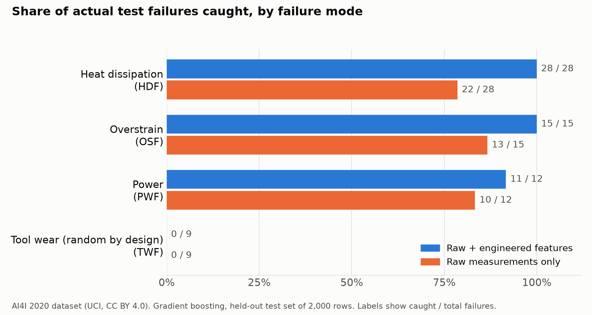

# Machine Failure Prediction with Engineering Features (AI4I 2020)

A predictive maintenance study on the public AI4I 2020 dataset. The question is simple: given the process conditions of a milling operation, will the machine fail?

The study compares a model that sees only the raw sensor values with a model that also receives three physical quantities a maintenance engineer would look at first: temperature difference, mechanical power and tool load. A rule set taken directly from the dataset documentation is included as a reference point.

**Live demo:** [Hugging Face Space](https://huggingface.co/spaces/ALP-hface/ai4i-failure-prediction) and [GitHub Pages](https://alp-gthub.github.io/ai4i-predictive-maintenance/). The demo runs entirely in the browser. Its predictions were checked against the Python model on all 10,000 dataset rows and 20,000 random inputs with no decision differences (`results/web_export_check.json`).

**Model:** [ALP-hface/ai4i-failure-prediction-model](https://huggingface.co/ALP-hface/ai4i-failure-prediction-model) on Hugging Face.

## Data

| | |
|---|---|
| Source | [UCI Machine Learning Repository, dataset 601](https://archive.ics.uci.edu/dataset/601) |
| Rows | 10,000 |
| License | Creative Commons Attribution 4.0 International (CC BY 4.0) |
| Nature | Synthetic, described by its publisher as reflecting real predictive maintenance data from industry |
| File used | `data/ai4i2020.csv`, unchanged from the official download |
| SHA-256 | `dc6630cd9b1f0f853922fad78a1b6436570d3f1ec863f1dd5c4340ac56bc8a8e` |

Citation: AI4I 2020 Predictive Maintenance Dataset [Dataset]. (2020). UCI Machine Learning Repository. https://doi.org/10.24432/C5HS5C

Introductory paper: S. Matzka, "Explainable Artificial Intelligence for Predictive Maintenance Applications", International Conference on Artificial Intelligence for Industries, 2020.

### What the data contains

Inputs: product quality type (L, M, H), air temperature [K], process temperature [K], rotational speed [rpm], torque [Nm] and tool wear [min].

Target: `Machine failure`, set when at least one of five failure modes occurs. The documentation defines them as follows.

| Mode | Documented condition |
|---|---|
| TWF, tool wear failure | Tool is replaced or fails at a random wear time between 200 and 240 min |
| HDF, heat dissipation failure | Process minus air temperature below 8.6 K and speed below 1380 rpm |
| PWF, power failure | Torque × angular speed below 3,500 W or above 9,000 W |
| OSF, overstrain failure | Tool wear × torque above 11,000 / 12,000 / 13,000 min·Nm for L / M / H |
| RNF, random failure | 0.1 % chance regardless of conditions |

### Checks performed on the file

These were measured on the official file and are recorded in `results/metrics.json`.

* The documented rules reproduce the HDF, PWF and OSF flags for all 10,000 rows without a single difference. The data was generated from these rules.
* HDF (115), PWF (95) and OSF (98) counts match the documentation.
* Some figures do not match the documentation:
  * Product type shares are 60.0 % L, 30.0 % M, 10.0 % H. The documentation states 50 / 30 / 20.
  * There are 46 TWF flags. The documentation mentions 51 tool wear failures. Flagged rows have tool wear between 198 and 253 min, slightly outside the documented 200 to 240 min window.
  * There are 19 RNF flags. The documentation mentions 5. 18 of the 19 RNF rows have `Machine failure = 0`.
* 9 rows have `Machine failure = 1` with no failure-mode flag. 24 rows carry more than one mode.

The study uses the file as published and does not correct these points.

## Method

**Inputs.** Only the six process measurements are used. The five failure-mode flags are labels and are never given to the model, since that would hand it the answer.

**Engineered features.** Three physical quantities, each corresponding to a documented failure mechanism:

* Temperature difference: `ΔT = T_process − T_air` [K]
* Mechanical power: `P = torque × rpm × 2π / 60` [W]
* Tool load: `tool wear × torque` [min·Nm]

The model receives these quantities but not the thresholds. It has to learn where the limits are.

**Models.**

1. Logistic regression on raw measurements (baseline)
2. Gradient boosting (scikit-learn `HistGradientBoostingClassifier`) on raw measurements
3. Gradient boosting on raw measurements plus engineered features (used in the demo)
4. Documented physical rules applied directly (reference, no learning)

**Evaluation.** 20 % of the data is held out as a stratified test set and is not touched during training. Five-fold cross-validation on the remaining 80 % checks how stable the results are. Failures are rare (339 of 10,000 rows), so accuracy is not reported. It would be 96.6 % for a model that never predicts a failure.

## Results



<!-- RESULTS:START -->
Test set: 2,000 rows held out from training (68 actual failures), stratified split, seed 42.

| Approach | Precision | Recall | F1 | PR-AUC | Missed failures | False alarms |
|---|---|---|---|---|---|---|
| Logistic regression, raw measurements | 63.6% | 10.3% | 0.177 | 0.424 | 61 | 4 |
| Gradient boosting, raw measurements | 88.7% | 69.1% | 0.777 | 0.855 | 21 | 6 |
| Gradient boosting, raw + engineered features | 94.9% | 82.4% | 0.882 | 0.901 | 12 | 3 |
| Documented physical rules (reference, no learning) | 100.0% | 83.8% | 0.912 | n/a | 11 | 0 |

Five-fold cross-validation on the training set (mean ± standard deviation):

| Model | F1 | PR-AUC |
|---|---|---|
| Logistic regression, raw measurements | 0.309 ± 0.031 | 0.470 ± 0.033 |
| Gradient boosting, raw measurements | 0.732 ± 0.048 | 0.805 ± 0.034 |
| Gradient boosting, raw + engineered features | 0.853 ± 0.016 | 0.880 ± 0.024 |

Actual test failures caught, by failure mode:

| Failure mode | Failures | Boosting, raw | Boosting, engineered | Documented rules |
|---|---|---|---|---|
| HDF | 28 | 22 | 28 | 28 |
| OSF | 15 | 13 | 15 | 15 |
| PWF | 12 | 10 | 11 | 12 |
| TWF | 9 | 0 | 0 | 0 |
| HDF+PWF | 1 | 1 | 1 | 1 |
| TWF+OSF | 1 | 1 | 1 | 1 |
| no mode flag | 2 | 0 | 0 | 0 |
<!-- RESULTS:END -->

## Interpretation

* **Physical features matter more than the choice of algorithm.** Gradient boosting with raw values misses heat dissipation and overstrain cases because each depends on a combination of two measurements. Given ΔT, power and tool load, the same algorithm catches almost every failure that has a physical cause.
* **The documented rules are the ceiling.** They catch every HDF, PWF and OSF failure because the data was generated from them. The trained model comes close without being told the thresholds.
* **Tool wear failures are not predictable here.** The dataset assigns them at a random wear time, so no model or rule can catch them reliably. In a real plant this is solved with a wear-based replacement schedule, not with a classifier.
* **False alarms sit near the limits.** The model's false alarms are cases close to a documented threshold, for example tool load just under 11,000 min·Nm or power just above 3,500 W.

## Limitations

* The dataset is synthetic and its failures follow fixed rules. High scores here do not mean the same approach will perform equally well on real machine data, where limits are not sharp and sensors are noisy.
* One random split was used for the test figures. Cross-validation spread is reported to show variability.
* The thresholds in the demo belong to this dataset, not to any real machine.

## Reproduce

```bash
pip install -r requirements.txt
python -m src.train --data data/ai4i2020.csv   # trains, writes model/ and results/
python -m src.report                            # writes the results tables into this README
python -m src.plot                              # draws results/caught_by_mode.png
python -m src.export_web                        # exports the model to docs/ and checks it (needs Node.js)
python app.py                                   # optional: Gradio version of the demo, runs locally
```

Tested with Python 3.12.3 and the versions pinned in `requirements.txt`.

## Repository structure

```
docs/                   browser demo (Hugging Face Space and GitHub Pages)
app.py                  Gradio version of the demo, for local use
src/features.py         input columns, engineered features, documented rules
src/train.py            training and evaluation
src/report.py           writes results tables into README.md and the model card
src/plot.py             draws the results chart
src/export_web.py       exports the model for the browser and checks it against Python
src/check_web_model.js  runs the browser predictor in Node.js for that check
data/ai4i2020.csv       official dataset file (CC BY 4.0)
model/model.joblib      trained model used by the demo
results/metrics.json    every reported number
results/caught_by_mode.png  results chart
results/web_export_check.json  browser vs Python comparison
.github/                workflow and script that publish to Hugging Face
```

## Türkçe özet

Bu çalışma, kamuya açık AI4I 2020 kestirimci bakım veri setinde bir freze operasyonunun arızaya gidip gitmeyeceğini tahmin ediyor. Yalnızca ham sensör değerlerini gören bir model ile, bakım mühendisinin ilk bakacağı üç fiziksel büyüklüğü de alan bir model karşılaştırılıyor: proses ve ortam sıcaklık farkı, mekanik güç (tork × açısal hız) ve takım yükü (aşınma × tork).

Sonuç: aynı algoritma, fiziksel büyüklükler verildiğinde fiziksel nedeni olan arızaların neredeyse tamamını yakalıyor. Takım aşınması arızaları veri setinde rastgele atandığı için öngörülemiyor; sahada bu konu sınıflandırıcıyla değil, aşınmaya dayalı değişim planıyla çözülür. Veri sentetik olduğu ve arızalar sabit kurallardan üretildiği için buradaki skorlar gerçek makine verisine doğrudan taşınamaz.

## Author

ALP ATA
